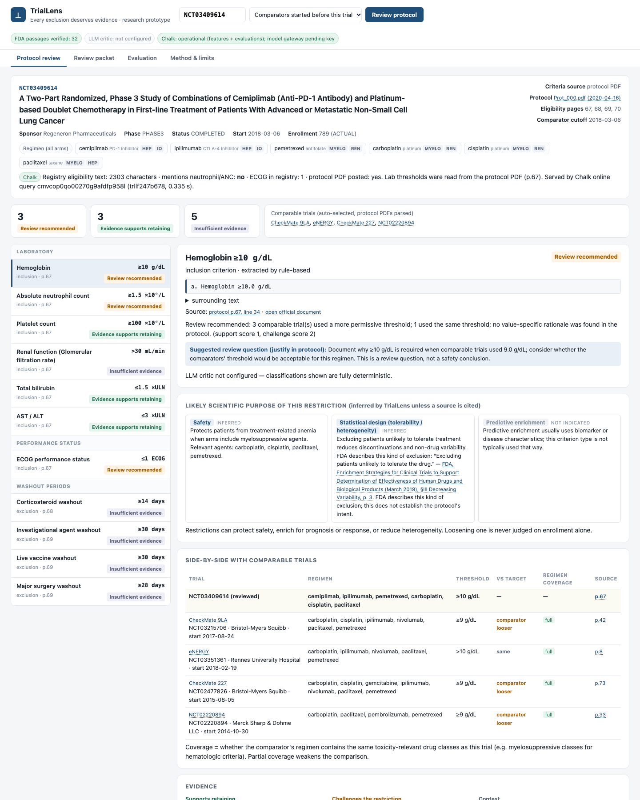
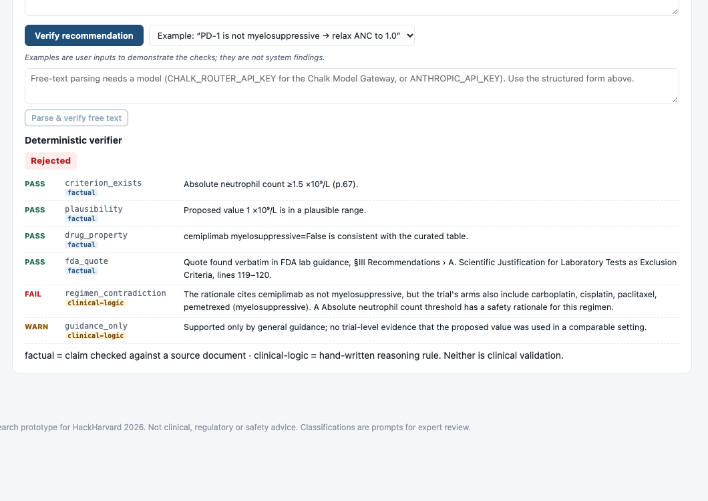

# ProtocolOS

**Every exclusion deserves a rationale.**

ProtocolOS (formerly TrialLens) helps protocol teams check the rationale behind each eligibility criterion of an oncology trial: lab thresholds, ECOG performance status and washouts. It reads the protocol PDF posted on ClinicalTrials.gov, compares each criterion with earlier comparable trials and FDA final guidance (July 2026), and verifies every suggested change with a deterministic verifier. The team decides; ProtocolOS prepares the rationale and a review packet.

Two modes:
- **Finishing a trial:** review an existing protocol: Rationale badges with the arm that drives a safety rationale, Compare, Ask, a Redraft workspace with live deterministic checks, Decide with structured reasons, and an exportable review packet.
- **Create criteria from an idea:** draft criteria for a new trial concept from verified precedents only, with a self-critique of each draft and a before/after against a real protocol.

| Link | |
|---|---|
| Web app | https://protocolos-web.vercel.app (routes `/`, `/review`, `/draft`, `/tour`, `/tour/draft`) |
| Engine API | https://protocolos-api-production.up.railway.app (`/docs` is the OpenAPI page) |
| Guided demos | https://protocolos-web.vercel.app/tour (mode A) and https://protocolos-web.vercel.app/tour/draft (mode B) |
| Repository | https://github.com/rinatrizvanov/ProtocolOS |

> Research prototype built at HackHarvard 2026 (Regeneron "Reinvent Clinical Trials & Drug Development"; Chalk "Best Data-Driven Agent Built on Chalk"). Not clinical, regulatory or safety advice. Classifications are prompts for expert review.



---

## The problem

Eligibility criteria are decided largely from precedent and habit. Regeneron's own starter material describes protocol teams that "rarely get evidence-based feedback on their draft until it's too late to change cheaply." In July 2026 FDA issued final guidance on exactly these criteria in three oncology documents: laboratory values, performance status, and washout periods. They state that "unnecessarily restrictive eligibility criteria may slow subject accrual, limit patients' access to clinical trials, and lead to trial results that do not fully represent treatment effects…"

But restrictions exist for reasons: patient safety, predictive or prognostic enrichment, reduced heterogeneity, interpretability. "Loosen the criteria" misses most of the problem. The useful question is narrower: **which restrictions deserve reconsideration, and what evidence supports or contradicts each one?**

The evidence is scattered. For EMPOWER-Lung 3 (Regeneron, NCT03409614), the registry text never mentions a neutrophil threshold. The lab criteria exist only on page 67 of a 170-page protocol PDF, and comparable trials' thresholds sit in other sponsors' PDFs.

**Retrospective use of the 2026 guidance.** EMPOWER-Lung 3 and its comparators were designed years before FDA's final guidance (July 2026). ProtocolOS applies that guidance as a present-day review standard. It does not judge what those teams could have known when they designed their trials.

### Worked example: EMPOWER-Lung 3 hemoglobin ≥10 g/dL

ProtocolOS examines the trial's own context before looking at peers:
- **Own arms.** The regimen contains carboplatin, cisplatin, paclitaxel and pemetrexed.
- **Own protocol.** Page 51 notes that grade 3–4 anemia was higher with pemetrexed.

A plausible safety rationale therefore exists. A toxicity rationale supports having *a* threshold, though, not this exact number, and the protocol does not say why 10 rather than 9 was chosen.

Among comparable trials started earlier:
- Three used ≥9 g/dL (CheckMate 9LA, CheckMate 227, KEYNOTE-042).
- One (eNERGY) used >10 g/dL.
- EMPOWER-Lung 1 (cemiplimab monotherapy vs platinum-doublet chemotherapy) and KEYNOTE-189 also used ≥9 g/dL. ProtocolOS did not select them as automatic comparators.

ProtocolOS classifies this as *Review recommended*: a clinical review question for the protocol team. It is **not** a finding that the threshold is a mistake or that it unjustifiably excludes patients.

Several things are not shown by this evidence:
- **Protocol version.** The posted protocol is Amendment 5, not necessarily the design-time version. Nothing here shows whether the threshold changed across amendments.
- **Influence from EMPOWER-Lung 1.** Nothing here shows that EMPOWER-Lung 1 shaped EMPOWER-Lung 3's design.
- **Optimal threshold.** No outcome data identify which threshold is best.

## Who it is for and where it fits

Clinical scientists, protocol authors, medical reviewers and cross-functional protocol-review teams. It fits **before protocol finalization**, as preparation for the protocol review meeting. ProtocolOS gathers and checks the evidence; the team decides.

## What it does

| Step | What happens | How |
|---|---|---|
| Ingest | NCT ID → ClinicalTrials.gov record + posted protocol PDF (cached) | Deterministic; registry text as a fallback |
| Extract | Hemoglobin, ANC, platelets, bilirubin, AST/ALT, renal function, ECOG, washouts, with operators, units, conditions (e.g. liver metastases) and the **verbatim source line and page** | Rule-based parser (handles tables, garbled PDF glyphs, image-only pages) |
| Regimen | Drugs in every arm, each with its source; agents unknown to the curated table are listed, never assumed harmless | Registry + protocol dosing context; curated class table |
| Comparators | Phase 3 trials in the same disease, setting and histology, with overlapping drug classes and posted protocols, **started before the reviewed trial** | Registry search, then the same extractor on their PDFs |
| Guidance | 32 passages from FDA final guidance (July 2026) on eligibility and the 2019 enrichment guidance, **verified verbatim against the PDFs** at startup, with section, page and line | Deterministic |
| Review | Each criterion: *Review recommended* / *Rationale supports keeping* / *Insufficient evidence*, plus rationale categories (safety, efficacy enrichment, regulatory precedent; inferred), the arm that drives a safety rationale, supporting, challenging and context evidence by tier, missing evidence, and a cautious next action | Transparent rules |
| Verify | Any recommendation (from a reviewer, a model, or a test case) is checked. **Factual** checks: source existence, verbatim quotes, values, units. **Clinical-logic** rules: regimen contradiction, direction, evidence sufficiency, overclaiming. Outcomes: *Supported*, *Supported with qualifications*, *Rejected*, *Needs medical review* | Deterministic |
| Redraft | A reviewer types a new limit and a one-line rationale; the verifier re-runs as they type and flags mismatches with precedents or FDA guidance | Deterministic |
| Decide | A decision per criterion with a structured reason (safety concern, regulatory requirement, efficacy enrichment, prior trials, operational reason, other); free text only for exceptions | Recorded in the packet |
| Packet | Exportable review packet (Markdown / printable PDF / JSON) with decision fields: accept / reject / **needs medical review** / defer | Deterministic |
| Draft (mode B) | From an idea (condition, drugs, setting, phase, cutoff date): find earlier comparable trials, propose each criterion only from a verified precedent, otherwise *Insufficient evidence*; self-critique each draft; before/after against a real protocol | Deterministic, verifier-gated |

Rules that keep the reasoning honest:
- A toxicity link supports having *a* threshold, never a specific value.
- A more permissive comparator shows a threshold was *used*, not that it was safe.
- Agreement among comparators may reflect template carry-forward (FDA lab guidance §II).
- When no comparable precedent exists, the answer is "Insufficient evidence", not "retain".

### Where AI is and is not used

The evidence engine is **deterministic and auditable**; it is not an autonomous AI scientist. A language model, when configured (the Chalk Model Gateway, or the Anthropic API), does two things:
- It critiques a flag, and may only *downgrade* it.
- It turns a reviewer's free-text challenge into structured claims, which then pass through the deterministic verifier.

Documents are treated as data. PDF text is never executed as instructions, the model has no tools or write access, and every displayed value links to its source page. This mitigates the OWASP prompt-injection and excessive-agency risks noted in Regeneron's mentor guidance.



## Chalk integration (what actually ran)

| Chalk capability | Role in ProtocolOS | Status (2026-10-18) |
|---|---|---|
| Features + online resolver | `Trial` features resolved live from ClinicalTrials.gov inside Chalk. The dashboard shows, per trial, whether the registry even mentions lab thresholds (usually not), which is why ProtocolOS reads the PDF | **Deployed; online queries succeed from the CLI and the local app** |
| Chalk Compute + Evaluations | The verifier runs as a Chalk function over 39 test cases; Chalk scorers grade it | **Ran** in the collaborator's environment: evaluation `cmvco3m0n01dw01y520oc80sq`, run `e61fce6c-…`, SUCCEEDED, 0 task errors (`data/chalk_eval_run.json`) |
| Evaluation `protocolos-investigator` | Planted defects in the investigator's answers, graded by the answer checker | **Local only** (`evals/investigator/results.json`); not yet run on Chalk |
| Model Gateway (router) | Optional model mode: critic (may only downgrade a flag), free-text questions, every statement checked | **Works locally with a router key**; off on the public deploy (the demo guard keeps it deterministic) |

Details and reproduction: [CHALK.md](CHALK.md).

## Evaluation

All numbers are produced by scripts in `evals/` from official documents and hand-labelled answer keys. Gold labels are from a single annotator (the developer). **None of this is clinical validation.**

**A. Original protocols (19 real protocols: NSCLC, SCLC, TNBC, gastric, HCC, head & neck, renal)**

| Measure | Result |
|---|---|
| Criterion extraction, all labelled criteria | 122/128 correct; precision 97.6% (3 extracted values known wrong) |
| — development protocols | 54/55 |
| — held-out (outputs seen once, no changes) | 18/19 |
| — unseen set 1, **first run** | **15/21** → 21/21 after one fix (synopsis vs full eligibility section). The first-run number is the honest estimate. |
| — unseen set 2 (6 protocols, measured once, not tuned) | **29/33**; CASPIAN labs missed (wrong section), 2 KEYNOTE-048 table values wrong |
| Comparator threshold direction | 1780/1802 correct where both values were extracted (22 errors, all from the wrong extractions above) |
| FDA quotes verified verbatim / protocol source lines on cited page | 32/32 · 157/157 |
| Regimen (developer-curated reference) | precision 98.2%, recall 100% (12 protocols) |

**B. Planted-issue variants: synthetic modifications to authentic, previously unseen protocols** (method from Regeneron's *Trial by Design, Part 2*). One threshold was made stricter (24 variants) or looser (10) on the protocol's own source line, across 5 protocols, with unmodified controls. A stricter criterion is not assumed wrong. The test is whether ProtocolOS notices and **escalates it for evidence review**.

| Run | Planted value extracted | Discrepancy surfaced | Escalated "Review recommended" | Never "Rationale supports keeping" | Looser plants falsely flagged |
|---|---|---|---|---|---|
| First run | 23/24 | 18/24 | 18/24 | 23/24 | 0/10 |
| After fixes, historical comparators only | 24/24 | 14/24 | 16/24 | 24/24 | 0/10 |
| After fixes, all comparators (reviewing a draft today) | 24/24 | 24/24 | 22/24 | 24/24 | 0/10 |

The first run found three bugs:
1. Agents outside the drug table (axitinib, sunitinib) were treated as "no myelosuppressive agent".
2. SCLC trials received NSCLC comparators.
3. A harness bug left "1,500/µL" unmodified.

Some first-run escalations came from bugs 1 and 2, which is why the historical-cutoff numbers went *down* after fixing them. Remaining misses are protocols with no comparable precedent before their start date, where ProtocolOS correctly answers "Insufficient evidence". Unmodified controls: 14–17 of 42 criteria flagged, mostly from criterion-specific FDA recommendations (ECOG PS2, Duffy-null ANC); these are not counted as errors.

**C. Developer-designed verifier faults** (24 injected faults, 10 valid/cautious, 5 ambiguous)

| Verifier | Faults rejected | Valid rejected | Ambiguous flagged |
|---|---|---|---|
| None (baseline) | 0/24 | 0/10 | 0/5 |
| Deterministic, local | 24/24 | 0/10 | 5/5 |
| Deterministic, **on Chalk Compute** | 24/24 | 0/10 | 5/5 |

The cases and the verifier were written by the same developer, and most faults are factual (misquotes, wrong values) rather than clinical reasoning errors. Treat this as a test of designed behaviour, not of robustness.

**D. Model-based evaluations:** no model-based results are committed. `python -m evals.run_evals --llm` adds the LLM-only verifier baseline when a router or Anthropic key is present.

**E. Investigator answer checker** (`evals/investigator/results.json`, local; on EMPOWER-Lung 3, 11 criteria, 4 question types). The deterministic investigator's own answers: 44/44 not rejected. Planted defects (unknown trial ID, changed number, causal phrase, one-word misquote, dropped counter-evidence, injected instruction): 336/336 rejected. The developers wrote both the mutants and the checker, so this shows the checker catches these classes, not defects a model would produce.

**F. Draft guardrails, leave-one-out** (`evals/draft/results.json`). For each of 4 cached trials, ProtocolOS drafts criteria from the trial's own idea at its start date, with the trial itself excluded. Drafted without a verified precedent: 0. Overclaim failures: 0. Drafted values equal to the trial's own value: 22/31. Agreement is not correctness: a precedent shows a value was used, not that it was right.

**Measured context (NHANES 2017-2018, `evals/impact/impact_numbers.json`).** `python -m scripts.impact_numbers` computes the survey-weighted share of US adults below the EMPOWER-Lung 3 hemoglobin threshold (≥10.0 g/dL) and below the ≥9.0 g/dL used by CheckMate 9LA and CheckMate 227, with standard errors. It is a US general-population share, not a trial-eligible share, and not an enrollment prediction.

## Quick start (clean clone)

Full instructions: [docs/INSTALL.md](docs/INSTALL.md). uv is not required. You need Python 3.12 or newer, Node.js 20.9 or newer for the web app, and preferably poppler (`pdftotext`; pypdf is used otherwise).

```bash
git clone https://github.com/rinatrizvanov/ProtocolOS.git && cd ProtocolOS
python3 -m venv .venv
.venv/bin/pip install $(.venv/bin/python -c "import tomllib;d=tomllib.load(open('pyproject.toml','rb'));print(' '.join(d['project']['dependencies']+d['dependency-groups']['dev']))")
.venv/bin/python -m scripts.prewarm --drafts NCT03409614 NCT02578680 NCT03088540 NCT02819518   # fetch documents, cache reviews and draft presets
.venv/bin/uvicorn trialforge.api:app --port 8765                                # engine + vanilla dashboard: http://localhost:8765, API docs at /docs
cd web-next && npm ci && npm run dev -- -p 3765                                 # second terminal: Next.js app at http://localhost:3765
```

Add `PROTOCOLOS_PUBLIC=1` before `uvicorn` to run with the public-demo guard, as deployed (cached reviews only, no recompute, no model calls). Optional keys (model mode via the Chalk Model Gateway, the Chalk registry chip) are listed in `.env.example`; without them model mode says "not configured". Never commit `.env`.

**Guided tours:** `/tour` walks through mode A on EMPOWER-Lung 3 hemoglobin; `/tour/draft` walks through mode B on the EMPOWER-Lung 3 design-time preset. Both work on the deployed app and locally.

**Tests, evals and checks** (the full table, with what each one proves, is in [docs/DEMO_GUIDE.md](docs/DEMO_GUIDE.md)):

```bash
.venv/bin/python -m pytest -q tests/                          # engine unit and API tests
(cd web-next && npm run build && npx tsc --noEmit && npm run lint)
.venv/bin/python -m evals.run_evals                           # A + C (downloads the evaluation protocols on first run)
.venv/bin/python -m evals.planted.make_variants && .venv/bin/python -m evals.run_planted   # B
.venv/bin/python -m evals.investigator.run                    # E
.venv/bin/python -m evals.draft.run                           # F
.venv/bin/python -m scripts.check_numbers                     # every number in this README matches a committed result
```

## Repository layout

| Path | Contents |
|---|---|
| `trialforge/` | Engine: `sources`, `extract`, `druglib`, `comparators`, `guidance`, `review`, `verifier`, `draft`, `graph`, `investigate`, `packet`, `llm`, `chalk_bridge`, `nhanes`, `demo_guard`, `api` (the Python package keeps its original name) |
| `web-next/` | Next.js app (primary UI): both modes and the guided tours |
| `web/` | Vanilla-JS dashboard served by FastAPI at `/` (no build step) |
| `evals/` | Gold labels, verifier cases, planted-issue generator, investigator and draft evals, impact numbers, runners |
| `scripts/` | Prewarm, numbers check, brand check, smoke test, clean-clone test, browser end-to-end checks |
| `chalk_project/` | Chalk feature store and Chalk Evaluation bundle |
| `docs/` | [Install](docs/INSTALL.md), [demo and test guide](docs/DEMO_GUIDE.md), [deploy](docs/DEPLOY.md), demo script, Devpost text, deck, screenshots, [teammate onboarding](docs/TEAMMATE_ONBOARDING.md) |
| `tests/` | Engine unit and API tests |

## Limitations

- **Blind spot.** ProtocolOS sees public documents only. Rationale in non-public sources (preclinical toxicology, internal development data, regulator correspondence) cannot be seen, so "no rationale found" never means "no rationale exists".
- **Protocol versions.** Protocol PDFs on ClinicalTrials.gov are usually the final amendment, not the design-time draft (EMPOWER-Lung 3's posted protocol is Amendment 5). ProtocolOS does not track amendment history, so it cannot say whether or why a threshold changed.
- **Retrospective guidance.** FDA's final guidances (July 2026) post-date most reviewed trials and are applied retrospectively; FDA citations are marked "retrospective" when issued after the trial's start date.
- **Coverage.** Many recent phase 3 oncology trials do not post a protocol PDF on ClinicalTrials.gov; for those, only the registry text can be read, and it rarely states lab thresholds.
- **Extraction.** It is rule-based and misses unusual layouts; known failures are listed in the Evaluation section.
- **Drug table.** The pharmacology table is curated at class level and not re-verified against current labels.
- **Purpose tags.** Rationale categories are inferred, not read from the protocol.
- **Classification.** It is a transparent heuristic, not a validated model, and no clinician has reviewed the outputs.
- **Gold labels.** Single annotator.
- **NHANES panel (secondary).** It describes the US general population, not people with cancer, and is not an enrollment prediction. Race/ethnicity is not a proxy for Duffy-null phenotype.

**Claims ProtocolOS does not make:**
- That any threshold is safe to change.
- That a threshold differing from peer trials is a mistake.
- That one trial's results caused another trial's design choices.
- That a change would improve enrollment, timelines or cost.
- That any output is clinically validated.
- That it learns from the team's decisions: decisions and reasons are recorded in the packet, not used to retrain anything.

## License and third-party data

The code is MIT-licensed (see [LICENSE](LICENSE)). Third-party data (ClinicalTrials.gov records, sponsor protocol PDFs, FDA guidance, NHANES files) is downloaded from its official source at runtime, is not redistributed in this repository and is not covered by this license; it remains under its own terms.
