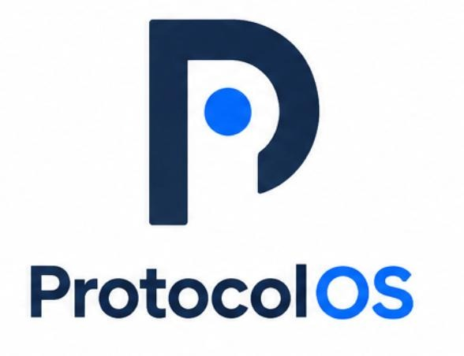
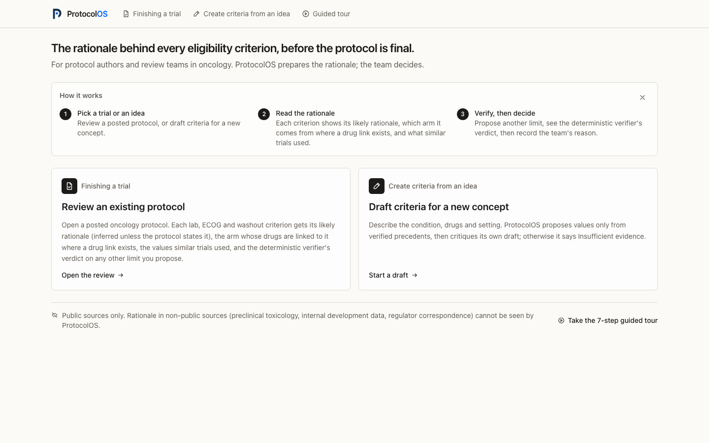
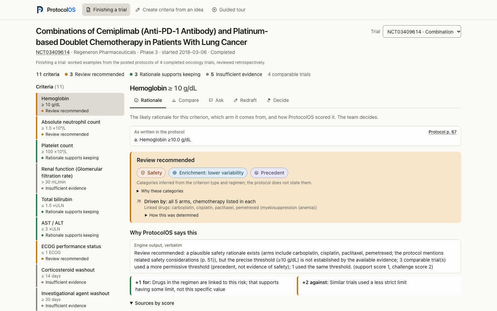
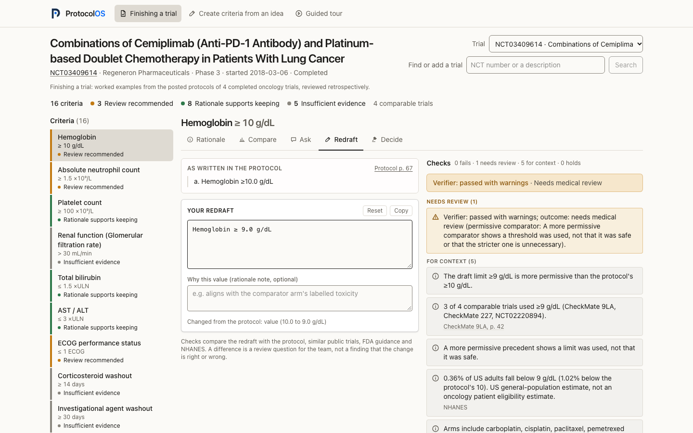
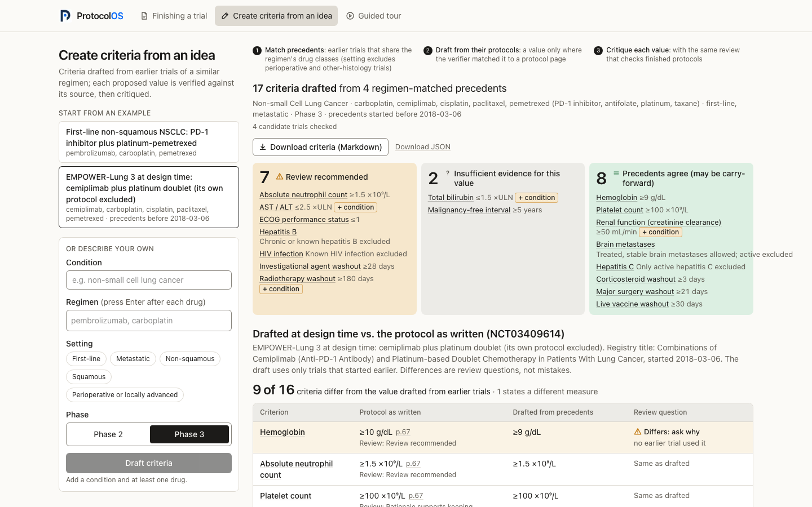
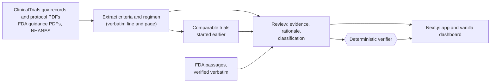

<p align="center"></p>

<h3 align="center">Every exclusion deserves a rationale.</h3>

Eligibility criteria (lab thresholds, ECOG performance status, washout periods, and conditions such as brain metastases, HIV, hepatitis B and C, prior cancers and QTc) decide who may join a cancer trial, and they are often carried forward from earlier protocols without a written reason. FDA's final guidance of July 2026 says lab restrictions from earlier trials "should not be carried forward automatically", but restrictions also exist for real reasons: safety, enrichment, interpretability. **ProtocolOS** shows a protocol team the likely rationale behind each criterion of an oncology protocol, compares it with earlier comparable trials and FDA guidance, checks every suggested change with a deterministic verifier, and can draft criteria for a new trial idea from verified precedents only. The team decides; ProtocolOS prepares the rationale and a review packet.

ProtocolOS (formerly TrialLens) was built at HackHarvard 2026 for the Regeneron "Reinvent Clinical Trials & Drug Development" and Chalk "Best Data-Driven Agent Built on Chalk" tracks. The Chalk integration was removed after the event; the submitted state is the git tag `hackharvard-submission`. It is a research prototype, not clinical, regulatory or safety advice.

## Try it

| What | URL |
|---|---|
| Web app | https://protocolos-web.vercel.app |
| Worked example, mode A (EMPOWER-Lung 3 hemoglobin) | https://protocolos-web.vercel.app/review?nct=NCT03409614&c=hemoglobin |
| Worked example, mode B (EMPOWER-Lung 3 at design time) | https://protocolos-web.vercel.app/draft?preset=el3-design-time |
| Guided tour, mode A (reviewing a protocol) | https://protocolos-web.vercel.app/tour |
| Guided tour, mode B (drafting from an idea) | https://protocolos-web.vercel.app/tour/draft |
| Engine API and OpenAPI page | https://protocolos-api-production.up.railway.app/docs |
| Vanilla dashboard (served by the engine) | https://protocolos-api-production.up.railway.app |

Four completed trials are preloaded and open at once. Anyone can also add another trial by its NCT number, draft criteria for a new idea, or ask for model-written answers in the Ask tab. Those need your own OpenAI or Anthropic API key (see [Your own model key](#your-own-model-key)); the server has no model key of its own. Decisions you record are kept per browser. Trials you add, new drafts and decisions are stored on a volume, so they survive redeploys.



## Mode A: Finishing a trial

Pick a trial (EMPOWER-Lung 3, NCT03409614, is the worked example) and a criterion. ProtocolOS reads the thresholds from the protocol PDF posted on ClinicalTrials.gov, because the registry text rarely states them.

- **Rationale:** badges for the likely rationale (safety, efficacy enrichment, precedent; labelled as inferred), an arm line saying which arms list the agents behind a safety rationale, the verbatim protocol line and page, and the scoring behind the classification: *Review recommended*, *Rationale supports keeping* or *Insufficient evidence*.
- **Compare:** earlier comparable trials and the threshold each used, with regimen coverage.
- **Ask:** fixed questions ("Why was it flagged?", "What contradicts it?") answered from the evidence graph; every statement is checked against its source.
- **Redraft:** type a new limit and an optional rationale note; the deterministic checks re-run as you type.
- **Decide:** a decision with a structured reason (safety concern, regulatory requirement, efficacy enrichment, prior trial data, operational reason, other), then export the review packet as Markdown (the API also serves it as printable HTML and JSON).





**Worked example: EMPOWER-Lung 3 hemoglobin ≥10 g/dL.** Every arm contains chemotherapy, and the protocol (p. 51) notes higher grade 3-4 anemia with pemetrexed, so a plausible safety rationale exists. A toxicity rationale supports having *a* threshold, not this exact number. Among comparable trials that started earlier, CheckMate 9LA, CheckMate 227 and KEYNOTE-042 (NCT02220894) used ≥9 g/dL and eNERGY used >10 g/dL. ProtocolOS classifies the criterion *Review recommended*: a question for the protocol team, not a finding that the threshold is wrong. The posted protocol is Amendment 5, so nothing here shows how the threshold evolved, and no outcome data identify which threshold is best.

## Mode B: Create criteria from an idea

Enter a condition, drugs, setting, phase and a design date. ProtocolOS finds comparable trials that started before that date and drafts lab, ECOG, washout and condition criteria. Each proposed value is copied from a precedent whose threshold the verifier matched to its protocol page; without one, the criterion is *Insufficient evidence* and gets no value. The same review engine then critiques the draft, and a before/after compares it with a protocol as written. The preset "EMPOWER-Lung 3 at design time" drafts from that trial's own idea at its start date, with its own protocol excluded.



## How it works



- **Deterministic engine.** Extraction, comparator discovery, classification, the rationale report, redraft checks, drafting and the review packet are rule-based and auditable. Every displayed value links to its source page.
- **The verifier is the authority.** Any suggested change (from a reviewer, the redraft workspace, the draft module or a model) is a structured recommendation. Factual checks compare quotes, values and units with the sources; clinical-logic checks catch regimen contradictions, wrong direction, missing evidence and overclaiming. A threshold change that passes is still escalated to *Needs medical review*.
- **Model mode is optional and runs on your own key.** In the Ask tab a model of your choice (Anthropic or OpenAI) may write the answer from the criterion's evidence graph; every statement it returns passes the deterministic checks, failed statements are marked, and the answer's label can only go down. The API also offers a critic that may only downgrade a flag. Document text is treated as data, never as instructions; the model has no tools or write access.

Architecture, API and data schema: [docs/ARCHITECTURE.md](docs/ARCHITECTURE.md).

## Your own model key

The public server holds no model key, so nobody can spend tokens through it. Three things ask for yours:

| Action | What the key is used for |
|---|---|
| Add a trial that is not preloaded (Finishing a trial, "Add a trial") | Only checked. The analysis is rule-based and uses no model tokens; the key keeps the shared server open by limiting who can start new work. |
| Draft criteria for a new idea (Create criteria from an idea) | Only checked, as above. The examples open without a key. |
| Ask tab, "A model, with your key" | One model call per question, billed to your key. |

Providers and models: Anthropic (`claude-opus-5-5` by default, `claude-sonnet-5-5`, `claude-haiku-5-5`) and OpenAI (`gpt-6.1-sol` by default, `gpt-6-astra`, `gpt-6-luna`). The browser keeps the key in session storage for the current tab and sends it only with the requests above. The server checks it with the provider's models lookup (no tokens), keeps a hash of a checked key for ten minutes, and never writes the key to disk or logs. New analyses are also limited per visitor (address and key) per hour and per day across the server (`trialforge/access.py`).

## Evaluation

Every number below comes from a committed result file in `data/` or `evals/`; `python -m scripts.check_numbers` fails if a fraction or percentage in this README is not backed by one. Gold labels are from a single annotator. **None of this is clinical validation.**

**A. Real protocols** (19 protocols: NSCLC, SCLC, TNBC, gastric, HCC, head and neck, renal; `data/eval_results.json`)

| Measure | Result |
|---|---|
| Criterion extraction, all labelled criteria | 122/128 correct; precision 97.6% |
| First run on unseen set 1 | 15/21, then 21/21 after one fix; the first-run number is the honest estimate |
| Unseen set 2 (6 protocols, measured once, not tuned) | 29/33 |
| Comparator threshold direction, where both values were extracted | 1780/1802 |
| Condition criteria (brain metastases, HIV, hepatitis B, hepatitis C, prior malignancy, QTc), labelled on the same 19 protocols the rules were written on | 89/93 correct; 0/20 criteria the text does not state were extracted |
| FDA quotes verbatim / protocol source lines on the cited page | 45/45 · 239/239 |
| Regimen (developer-curated reference, 12 protocols) | precision 98.2%, recall 100% |

**B. Planted issues** (the method of Regeneron's *Trial by Design, Part 2*): one threshold made stricter (24 variants) or looser (10) on the protocol's own source line, in 5 real, previously unseen protocols. A stricter criterion is not assumed wrong; the test is whether ProtocolOS escalates it for review.

| Run | Planted value extracted | Escalated "Review recommended" | Never "Rationale supports keeping" | Looser plants falsely flagged |
|---|---|---|---|---|
| First run | 23/24 | 18/24 | 23/24 | 0/10 |
| After fixes, comparators started before the trial | 24/24 | 16/24 | 24/24 | 0/10 |
| After fixes, all comparators (reviewing a draft today) | 24/24 | 22/24 | 24/24 | 0/10 |

The first run found three bugs (agents outside the drug table treated as non-myelosuppressive, SCLC trials given NSCLC comparators, and a harness bug), which is why some first-run escalations disappeared after the fixes. The remaining misses are protocols with no comparable precedent before their start date, where ProtocolOS answers *Insufficient evidence*.

**C. Verifier** (39 developer-designed cases: 24 injected faults, 10 valid, 5 ambiguous): 24/24 faults rejected, 0/10 valid recommendations rejected and 5/5 ambiguous cases flagged, (`data/eval_results.json`; during the hackathon the same cases also ran on Chalk Evaluations with the same result). The same developer wrote the cases and the verifier, so this tests designed behaviour, not robustness.

**D. Investigator answer checker** (`evals/investigator/results.json`; EMPOWER-Lung 3, 16 criteria, 4 questions): 64/64 of the investigator's own answers not rejected; 484/484 planted defects rejected (unknown trial ids, changed numbers, causal phrases, misquotes, dropped counterevidence, injected instructions). This shows the checker catches these classes, not defects a model would produce.

**E. Drafting, leave-one-out** (`evals/draft/results.json`): each of 4 cached trials drafted from its own idea at its start date, itself excluded. Criteria drafted without a verified precedent: 0. Overclaim failures: 0. Drafted values or policies equal to the trial's own: 29/46. Agreement shows a value was used before, not that it is right.

**F. Population context** (`evals/impact/impact_numbers.json`): the survey-weighted share of US adults (NHANES 2017-2018) below the EMPOWER-Lung 3 hemoglobin threshold and below ≥9 g/dL, with standard errors. It describes the general population, not a trial-eligible population, and is not an enrollment prediction.

**G. Semantic comparator candidates** (`evals/semantic/results.json`): the 19 gold protocols reviewed twice, with comparators started before each trial: keyword discovery alone, then keyword plus the trials nearest in the semantic index (a local embedding model over the 1,412 phase 3 oncology trials with a posted protocol). Semantic candidates pass the same rules plus stricter ones the keyword query implies (shared cancer site, lung histology, breast subtype, no later-line, maintenance or radiotherapy programme for a target that is not one). 9 of 19 protocols got a different comparator set, 2 of the 4 with no keyword comparator got some, 19 comparators came only from the semantic index, and 20 of 250 criterion classifications changed (12 of them lab, ECOG or washout criteria, as before the condition criteria were added). A changed classification is a different review input, not an improvement: no gold label says which comparators are right. Evaluations A to F use keyword discovery; new analyses on the public server use both.

No model-based evaluation results are committed; `python -m evals.run_evals --llm` adds an LLM-only verifier baseline when a key is present.

## Quick start

Full instructions, Docker and checks: [docs/INSTALL.md](docs/INSTALL.md). You need Python 3.12 or newer, Node.js 20.9 or newer, and preferably poppler (`pdftotext`).

```bash
git clone https://github.com/rinatrizvanov/ProtocolOS.git && cd ProtocolOS
python3 -m venv .venv
.venv/bin/pip install $(.venv/bin/python -c "import tomllib;d=tomllib.load(open('pyproject.toml','rb'));print(' '.join(d['project']['dependencies']+d['dependency-groups']['dev']))")
.venv/bin/python -m scripts.prewarm --drafts            # fetch public documents, cache the demo reviews and draft presets
.venv/bin/uvicorn trialforge.api:app --port 8765        # engine + vanilla dashboard; API docs at /docs
cd web-next && npm ci && npm run dev -- -p 3765         # second terminal: http://localhost:3765
```

Checks: `.venv/bin/python -m pytest -q tests/`, `(cd web-next && npm run build && npx tsc --noEmit && npm run lint)`, `.venv/bin/python -m scripts.check_numbers`. The demo and test guide is [docs/DEMO_GUIDE.md](docs/DEMO_GUIDE.md); deployment is [docs/DEPLOY.md](docs/DEPLOY.md).

## Repository layout

| Path | Contents |
|---|---|
| `trialforge/` | Python engine and FastAPI app (the package keeps its original name) |
| `web-next/` | Next.js app: both modes and the guided tours |
| `web/` | Vanilla-JS dashboard served by the engine at `/` (no build step) |
| `evals/` | Gold labels, verifier cases, planted-issue generator, investigator and draft evaluations, runners |
| `scripts/` | Prewarm, numbers and brand checks, browser end-to-end checks, deploy smoke test, clean-clone test |
| `tests/` | Engine unit and API tests |
| `data/` | Committed evaluation results; document caches, reviews and decisions are created here at runtime (gitignored) |
| `docs/` | Architecture, install, demo guide, deploy guide, demo script, Devpost text, deck, screenshots |

Root files: `Dockerfile` and `railway.toml` (engine container), `pyproject.toml` and `uv.lock` (Python dependencies), `.env.example` (settings and optional local keys, names only).

## Limitations

- **Blind spot.** ProtocolOS sees public documents only. Rationale in non-public sources (preclinical toxicology, internal development data, regulator correspondence) cannot be seen, so "no rationale found" never means "no rationale exists".
- **Protocol versions.** Posted protocols are usually the final amendment, not the design-time draft; amendment history is not tracked.
- **Retrospective guidance.** The July 2026 FDA guidances post-date the reviewed trials, and the July 2020 ones post-date most of them; it is applied as a present-day review standard and labelled retrospective, not as a judgment of what the designers could have known.
- **Coverage.** Many phase 3 trials post no protocol PDF; for those only registry text, which rarely states lab thresholds, is available.
- **Method.** Extraction is rule-based and misses unusual layouts; the drug table is curated at class level; rationale categories are inferred; classification is a transparent heuristic, not a validated model; no clinician has reviewed the outputs.
- **NHANES** describes the US general population, not people with cancer. Race or ethnicity is not a proxy for Duffy-null phenotype.

ProtocolOS does not claim that any threshold is safe to change, that a difference from peer trials is a mistake, that one trial's results caused another's design, that a change would improve enrollment, timelines or cost, or that any output is clinically validated. Decisions and reasons are recorded in the packet; nothing learns from them.

## Related work

TrialPathfinder (Liu et al., *Nature* 2021) emulates trials on patient-level electronic health records to evaluate eligibility rules, and PyTrial collects machine-learning pipelines for trial search, outcome prediction and patient-trial matching, with criteria kept as free text. Both are third-party references, not dependencies: ProtocolOS works from public documents without patient data and structures each criterion with its source and rationale.

## Data sources and attribution

- **ClinicalTrials.gov** (U.S. National Library of Medicine), API v2: registry records and comparator search.
- **Sponsor protocol PDFs** posted on ClinicalTrials.gov; they remain the property of their sponsors.
- **FDA guidance:** *Cancer Clinical Trial Eligibility Criteria* on laboratory values, performance status, and washout periods and concomitant medications (July 2026); on brain metastases, on patients with HIV, hepatitis B virus or hepatitis C virus infections, and on patients with organ dysfunction or prior or concurrent malignancies (July 2020); and *Enrichment Strategies for Clinical Trials* (March 2019).
- **NHANES 2017-2018** (CDC, National Center for Health Statistics): demographics and complete blood count public-use files.

Third-party data is downloaded from its official source at runtime, is not redistributed in this repository and is not covered by this license; it remains under its own terms. No patient data is used.

## License

MIT. See [LICENSE](LICENSE).
